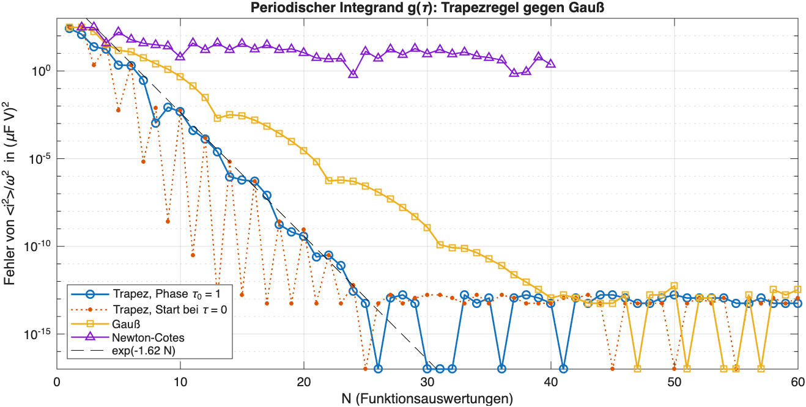

# PP3 Квадратуры: подробное объяснение (для себя, к тестату)

Формулы в LaTeX: в VS Code `Cmd+Shift+V`.

---

## 0. Что такое квадратурная формула

Хотим посчитать $I(f)=\int_a^b f(x)\,dx$, а интеграл взять не можем (или у нас только таблица значений). Берём **узлы** $x_i$ и **веса** $w_i$ и считаем
$$Q(f)=\sum_{i=1}^N w_i f(x_i).$$
Всё остальное в проекте это вопрос: *как выбрать $x_i, w_i$* и *что при этом происходит с ошибкой*.

**Интерполяционная формула.** Берём $N$ узлов, строим интерполяционный полином $p$ степени $N-1$ и интегрируем его: $Q(f)=\int p$. Тогда
$$w_i=\int_a^b \ell_i(x)\,dx,$$
где $\ell_i$ полиномы Лагранжа ($\ell_i(x_j)=\delta_{ij}$). Отсюда сразу: формула точна для всех полиномов степени $\le N-1$ (Satz 3.5).

**Степень точности (Exaktheitsgrad).** $m$ = наибольшая степень, до которой формула точна для всех полиномов. Достаточно проверить мономы $x^k$.

**Перенос на $[a,b]$ (Lemma 3.3).** Формулу строим один раз на $[-1,1]$ (`xh, wh`), потом
$$x=\tfrac{b-a}{2}\hat x+\tfrac{a+b}{2},\qquad w=\tfrac{b-a}{2}\hat w.$$
Это функция `transformiere`. Степень точности при этом не меняется (линейная замена не меняет степень полинома).

**Составная формула** (`summierte_formel`): делим $[a,b]$ на $M$ равных частей, на каждой применяем формулу. У Ньютона–Котеса крайние узлы общие у соседних частей: считаем в них $f$ один раз, веса складываем. Поэтому число вычислений $M(N-1)+1$, а не $MN$. У Гаусса крайних узлов нет, число вычислений $MN$.

---

## 1. Гаусс–Лежандр (`gauss_formel`)

**Идея.** Узлы тоже свободны: $2N$ параметров ($N$ узлов + $N$ весов) → можно добиться точности до степени $2N-1$. Это максимум (Satz 3.x): степень $2N$ невозможна, т.к. $\prod (x-x_i)^2\ge 0$ даёт интеграл $>0$, а формула даёт $0$.

**Как считать.** Узлы Гаусса это нули полинома Лежандра $P_N$. Они же собственные значения симметричной трёхдиагональной матрицы Якоби $J$: на диагонали $0$, на побочных диагоналях
$$\beta_k=\frac{1}{\sqrt{4-k^{-2}}}=\frac{k}{\sqrt{4k^2-1}},\quad k=1,\dots,N-1\qquad(\text{Prop. 3.24}).$$
Веса: $w_i=2\,v_{1,i}^2$, где $v_{\cdot,i}$ нормированный собственный вектор для $x_i$ (первая компонента, двойка = $\int_{-1}^1 1\,dx$). `eig` для симметричной матрицы устойчив, поэтому метод Golub–Welsch точный (до $\varepsilon$). В коде ещё симметризуем: $x_i=-x_{N+1-i}$.

**Свойство:** все $w_i>0$ ⇒ $\sum|w_i|=\sum w_i=2$ (точность для $f=1$).

---

## 2. Ньютон–Котес (`nc_formel`)

Узлы равноотстоящие, включая концы: $x_i=-1+2(i-1)/(N-1)$. $N=2$ трапеция, $N=3$ Симпсон, $N=5$ Буль.

Веса $w_i=\int\ell_i$. **Барицентрически**: $\ell_i(t)=\dfrac{\lambda_i/(t-x_i)}{\sum_j\lambda_j/(t-x_j)}$ (PP2), для равноотстоящих узлов $\lambda_i=(-1)^i\binom{N-1}{i}$. Сам интеграл от $\ell_i$ (степень $N-1$) считаем формулой Гаусса с $N$ точками — она точна до $2N-1\ge N-1$. Тонкость: узел Гаусса $t=0$ (при нечётном $N$) совпадает с узлом $x_i=0$, деление на ноль → там берём $\ell_i=\delta$ вручную.

**Степень точности:** $N$ нечётно → $N$ (а не $N-1$! из-за симметрии нечётные степени интегрируются точно), $N$ чётно → $N-1$.

**Проблема:** веса начинают менять знак и растут экспоненциально.

---

## 3. Aufgabe 1/2: что показывают графики

* Степень точности совпадает с теорией (Гаусс $2N-1$, NC $N$/$N-1$) для небольших $N$.
* **Конди­ция формулы.** Если значения $f$ возмущены на $\delta$: $|\tilde Q-Q|\le\sum|w_i|\cdot\max|\tilde f_i-f_i|$. Т.е. $\kappa_Q=\sum|w_i|$. Для Гаусса $\kappa_Q=2$ всегда (все $w_i>0$). Для NC при $N=20$ уже $\approx 126$, при $N=40$ около $1.6\cdot10^7$. Ошибки округления $\varepsilon\approx10^{-16}$ усиливаются в $\kappa_Q$ раз: $\varepsilon\kappa_Q\approx10^{-9}$ при $N=40$.
* Поэтому измеренная степень NC при $N\gtrsim 19$ (tol $10^{-14}$) падает до $-1$: даже $\int 1$ не получается с точностью tol. Это **не** ошибка теории, это округление (ответ на вопрос из задания: да, объясняет).
* У Гаусса измеренная степень получается **больше** $2N-1$ при больших $N$. Причина в тесте: ошибка на $x^{2N}$ равна $\sim 4^{-N}$, т.е. при $N=25$ это уже $<10^{-14}$, и мономы не отличают «точно» от «почти точно». Это ограничение теста, а не лучшая формула.

---

## 4. Aufgabe 3: составная квадратура, бюджет 48

Всего 48 вычислений $f$. Чем больше $N$ на кусок, тем меньше кусков $M$.

* **$f_1=e^x$ (аналитическая, гладкая):** хватает одного-двух кусков с достаточным $N$: Гаусс достигает $10^{-16}$ уже при $N\approx4$–5, NC при $N\approx8$. При больших $N$ NC **ухудшается** (рост $\kappa_Q$), Гаусс остаётся на уровне $\varepsilon$.
* **$f_2=\frac1{1+400(x-0.3)^2}$:** пик шириной $\sim0.05$, полюса $0.3\pm0.05i$ близко к оси. Полином высокой степени на всём $[0,1]$ плохо приближает такой пик (ширина мала, как в Runge). Лучше разбить на несколько кусков **среднего** $N$ (Гаусс $N=16,\ M=3$: $9\cdot10^{-8}$). Слишком малое $N$ даёт большую ошибку на куске с пиком, слишком большое $N$ (один кусок) тоже плохо.
* **$f_3=|\sin 5x|$:** излом в $x=\pi/5\approx0.63$. Функция не гладкая ⇒ порядок сходимости определяется изломом, а не $N$: ошибка $\sim h^2$, и $N$ почти ничего не даёт. Здесь помогает только $M$ побольше (мелкое разбиение). Колебания ошибки по $N$ — это просто то, куда падает излом внутри куска.

---

## 5. Aufgabe 4: энергия конденсатора

$W=\int_0^{12}v\,C(v)\,dv=320\ln(1+\tfrac{144}{64})=377.1696\,\mu J$. Подынтегральная функция $f(v)=v\,C(v)$.

Прибор отдаёт $C(v_i)$ округлённым до $0.01\,\mu F$ ⇒ $|\tilde C-C|\le0.005\,\mu F$, $|\tilde f_i-f_i|\le0.005\,v_i$. Ошибка раскладывается:
$$\underbrace{Q(\tilde f)-W}_{\text{итог}}=\underbrace{Q(f)-W}_{\text{ошибка квадратуры}}+\underbrace{Q(\tilde f)-Q(f)}_{\text{ошибка данных}},\qquad |\text{данные}|\le0.005\sum_i|w_i|v_i.$$
Для Гаусса $\sum w_iv_i=\int v\,dv=72$ ⇒ оценка $0.36\,\mu J$ всегда. Для NC при больших $N$ оценка растёт (знакопеременные веса).

| Метод | точек для реального $<1\,\mu J$ | точек с гарантией |
|---|---|---|
| Гаусс (один) | 3 | **3** ($0.48+0.36=0.84$) |
| Ньютон–Котес (один) | 5 | 5 |
| Симпсон составной | 5 | 7 |
| Буль составной | 5 | 5 |
| Трапеция составная | 12 | 16 |

**Вывод:** Гаусс нужно меньше всего точек (3). Ошибка квадратуры у Гаусса падает очень быстро, ошибка данных остаётся $\le0.36$ и ниже уже не опускается (это «пол» из-за округления прибора). У NC при $N\gtrsim12$ ошибка данных начинает расти и перекрывает выигрыш.

**«Гарантированно ли достигнута цель?»** Ошибка данных ограничена гарантированно (оценка $0.36\,\mu J$). Ошибку квадратуры мы знаем только потому, что знаем $W$ (точное). На практике $W$ неизвестно, нужна оценка ошибки квадратуры по производным $f^{(2N)}$ (для Гаусса) — без неё гарантии нет. Узлы Гаусса иррациональные напряжения (прибор должен выставлять их), узлы NC удобнее (равные шаги).

---

## 6. Aufgabe 5: эксперимент D (периодический интеграл)

$v(t)=6+4\sin\omega t$, $i=C(v)v'$, нужен $\langle i^2\rangle$ за период. С $\tau=\omega t$: $g(\tau)=(C(6+4\sin\tau)\cdot4\cos\tau)^2$ периодична, интеграл по $[0,2\pi]$.

**Теория (Euler–Maclaurin).** Ошибка трапеции с шагом $h$ содержит члены $h^{2k}\,(f^{(2k-1)}(b)-f^{(2k-1)}(a))$. У периодической функции все они равны нулю ⇒ ошибка убывает **быстрее любой степени $h$**. Для аналитической $g$ в полосе $|\mathrm{Im}\,\tau|<s$ ошибка $\sim e^{-sN}$. Здесь особые точки там, где $v=\pm8i$, т.е. $\sin\tau=(\pm8i-6)/4$, откуда $s=1.62$.

**Ловушка с фазой.** $g(\tau)=G(\sin\tau)$, поэтому в ряде Фурье только $\cos(2m\tau)$ и $\sin((2m+1)\tau)$. Если узлы начинаются в $\tau=0$, все они попадают в нули синус-гармоник, и при **нечётном** $N$ первая «алиасная» частота $2N$ вместо $N$ ⇒ ошибка $\sim e^{-2sN}$ (измерено $e^{-3.24N}$, теория $e^{-3.245N}$), а $e(2N)=e(N)$ для нечётных $N$. Это артефакт симметричной выборки, а не свойство метода (при реальном измерении фаза произвольна). Поэтому оценка делается при общей фазе $\tau_0=1$.

Измерено (фаза $\tau_0=1$): фактор $\approx e^{-1.48N}$ (при $N\ge8$), теория $e^{-1.62N}$ (с полиномиальным множителем из-за двойного полюса). Ошибка устойчиво $<10^{-10}$: трапеция с $N=21$, Гаусс — с $N=32$. Гаусс медленнее: он не использует периодичность (на периодической функции он «тратит» узлы на концах). Ньютон–Котес вообще не сходится (рост весов).

---

## 7. Вопросы к тестату (с короткими ответами)

1. **Что такое степень точности и чему она равна у Гаусса?** Наибольшая $m$, что все полиномы степени $\le m$ интегрируются точно. Гаусс с $N$ узлами: $2N-1$.
2. **Почему больше $2N-1$ нельзя?** $\prod(x-x_i)^2$ степени $2N$ в узлах равен 0 ⇒ $Q=0$, а интеграл $>0$.
3. **Откуда берётся матрица Якоби?** Трёхчленная рекуррентность для ортогональных полиномов Лежандра; нули $P_N$ = собственные значения $J$; веса из первой компоненты собственных векторов (Prop. 3.24).
4. **Почему у NC при нечётном $N$ степень $N$, а не $N-1$?** Симметрия узлов: нечётные степени интегрируются точно «бесплатно».
5. **Что такое $\sum|w_i|$ и почему оно важно?** Кондиция формулы: усиление возмущений $f$. Для $w_i>0$ равна $b-a$; у NC растёт экспоненциально.
6. **Почему NC плохи при больших $N$?** Феномен Рунге + знакопеременные веса ⇒ большая кондиция, усиление округления.
7. **Составная формула: как считать число вычислений?** NC: $M(N-1)+1$; Гаусс: $MN$.
8. **Почему для $|\sin5x|$ не помогает большой $N$?** Излом: функция не из $C^{2N}$, порядок определяется гладкостью (Satz 3.19), $O(h^2)$.
9. **Разложение ошибки в задании про конденсатор?** Ошибка квадратуры + ошибка данных (Konditionszahl × ошибка измерения). Округления машинные пренебрегаем.
10. **Почему у периодической функции трапеция так хороша?** Euler–Maclaurin: краевые члены сокращаются, остаётся экспоненциальная сходимость.
